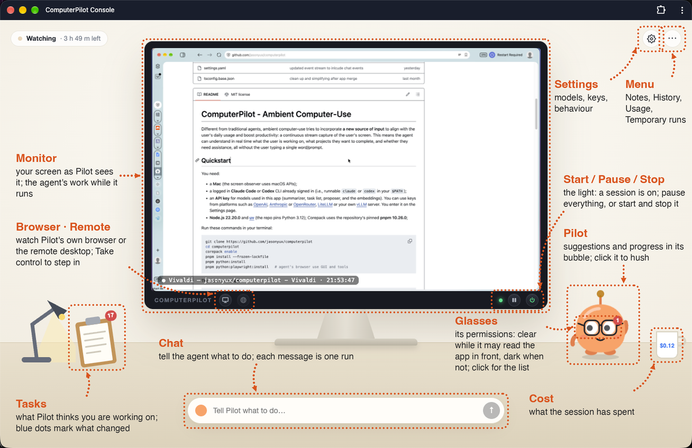

# Developing Cue

The [README](README.md) covers installing and using Cue. This page has what goes beyond it: the dev server, where things live, the checks, and the features kept out of the README (the agents' settings, the remote desktop, the deprecated agents, the other themes).

## Running

```bash
pnpm cue web   # the built app, as users run it: what `pnpm run build` made, without rebuilding
pnpm cue dev   # the console's dev server: it picks up your changes, and has what the built app leaves out
```

- `pnpm cue dev` needs no console build (the Python environment still comes from `pnpm run build`). It also has the theme picker with the other [themes](#themes), and the debug pages `/session` and `/v1/temporary`; the built app shows the Timeline v2 theme alone.
- `pnpm cue web` serves the last build: after changing the console or pulling new code, run `pnpm run build` again.
- Both start the backend on port **4041** and the console on **3000**, and Ctrl+C stops both. `HOST`, `PORT` and `RUNNER_BASE_URL`, in `.env` or the shell, move the backend.

## Where things live

- `console/`: the Next.js console; see its [README](console/README.md).
- `python-app/`: the backend (the screen observer, the notes, the task list, the suggestions, the agents); see its [DOCUMENTATION](python-app/DOCUMENTATION.md).
- `contracts/`: the request and event types the two share.
- `scripts/launch.mjs`: the launcher behind `pnpm cue`.
- `settings.yaml` and `.env`: a session's settings and the keys; the Settings page writes both.
- `python-app/data/`: everything Cue records, on your machine only.

## Checks

```bash
pnpm check:js       # lint, type-check, tests and a build of the console and the contracts
pnpm check:python   # ruff, mypy and pytest for the backend
pnpm check          # both
```

## Configuration tips

- Which models: we recommend Claude Sonnet 5.5/GPT-6.1-Sol or better for the `tasks` and `suggestions` modules, Claude Haiku 5.5 or GPT-6-Luna for `Notes` for balanced speed and cost, and an embedding model for the `Repeat Filter` (e.g., `text-embedding-3-small`).
- Replies are streamed by default, which keeps long reasoning calls alive through proxies like Cloudflare; switch streaming off in the Advanced view for an endpoint that cannot stream.
- If your model API comes from Amazon Bedrock, the Python app can also mint its own short-lived bearer tokens from your AWS credentials: run `aws configure`, then set the OpenAI key to literally `aws-bedrock-token-generator` and its base URL to your Bedrock endpoint (the region is read from it).

## Agents

A run (a chat turn, a temporary run, an accepted suggestion) is carried out by one of four agents. `actor.agents` in `settings.yaml` (or **Settings → Agents for chat and temporary runs**) sets which the session has; with more than one, each message picks.

### The Claude Code agent (default)

The `claude` agent hands a task to [Claude Code](https://claude.com/claude-code), started by the server itself through the Claude Agent SDK with your own Claude login, so it brings Claude's tools (shell, files, git, the web) and gets two more from us:
- **Desktop**: our accessibility-based `ax` tools, which act on your Mac's apps in the background without moving your mouse or taking your focus, so you keep working meanwhile.
- **Browser**: a browser of its own ([Playwright MCP](https://github.com/microsoft/playwright-mcp) attached to a headless Chrome the server runs), whose logins are kept under `python-app/data/agent-browser` between sessions. You watch it on the monitor; **Take control** lets you log in or step in by hand. (Google accounts refuse to sign in inside an automated browser; most other sites are fine.)

Where it works, in order: web pages in its browser; other apps on the remote desktop when the session has one (below); your own Mac only when the task needs what is there (your accounts, files, apps' data), and then it asks you first.

Things to know:
- When Claude Code's permission mode (`auto` by default) or your own `ask` rules hold a call back, the approval card and the run card show **Allow once** / **Deny**, and Claude waits for your answer.
- Optional settings, on the Settings page or under `actor` in `settings.yaml`: `claude_model` (as `claude --model` takes it), `claude_permission_mode`, `claude_cwd` (the folder Claude starts in; the run's own by default).
- The run uses your Claude login and reports its own cost, which the Usage page counts; the models on the Settings page are for the background modules only.

### The Codex agent (default)

The `codex` agent does the same with [Codex](https://developers.openai.com/codex) instead, through OpenAI's Codex SDK (the backend brings its own copy of Codex; sign in once with `codex login`). It gets the same desktop, browser and history tools, the same instructions and the same monitor, browser and remote-desktop views; your own Codex plugins, ChatGPT apps, MCP servers and Codex's built-in computer use and browser are switched off for its runs, so it uses ours. Set `actor.agents=codex` (or `claude,codex` to choose per message; the conversation's header then has an agent picker and a model picker listing what each agent offers your login). One difference from Claude Code: nothing is asked of you on the run card. Codex works in its sandbox (`actor.codex_sandbox`, `workspace-write` by default: files in its folder, no network for its shell), and Codex's own reviewer approves or denies any step beyond it; its verdicts show on the run card. Optional: `actor.codex_model`, `actor.codex_cwd`.

### Remote desktop (optional)

The agent can also work on an isolated Ubuntu desktop in a Docker container, so it never touches your files or accounts for tasks that need none of them. See the [remote desktop guide](python-app/app/live/actor/desktop/cua/README.md) for the container setup, then set `actor.desktop_source=local,remote` (or **Settings → Remote desktop**, which also takes the URL and the token). With it, the Claude Code agent prefers the remote desktop for anything that needs apps beyond the browser, and the monitor gets a **Remote desktop** view: it shows the remote desktop live, the agent's work included, and **Take control** lets you click and type there yourself.

### The desktop (GUI) agent (deprecated)

The `desktop` agent is an OpenAI model (`CUA_DEFAULT_MODEL`, through `OPENAI_API_KEY`) driving the same `ax` tools, and the remote desktop when set up, through a Python session (`exec_py`). It is the original agent of this repo: no shell or files, screen and apps only. Set `CUA_DESKTOP_MODE=accessibility` so it works through the Accessibility API rather than your real mouse and keyboard: in `pyautogui` mode it controls your real mouse and keyboard, and screenshots may include other windows, so prefer a dedicated desktop session for that mode.

### cmux + Claude Code (deprecated)

The earlier way to run Claude Code: inside a [cmux](https://github.com/manaflow-ai/cmux) terminal workspace, with cmux's computer-use tools and browser. It still works but is superseded by the Claude Code agent above, which needs no cmux. If you want it:

1. Install cmux and Claude Code. Make sure `claude` is already signed in, and that `cmux` and `claude` are in your `$PATH`.
2. Run `pnpm cmux:skills`, which installs cmux's browser skill into Claude Code (`~/.claude/skills/cmux-browser`).
3. Start the python server INSIDE a cmux session (run `pnpm cue web` from a cmux terminal), so it can reach cmux: cmux only accepts commands from processes started inside it.
4. Set the agent to `cmux` (`agents: [cmux]` under `actor` in `settings.yaml`, or on the Settings page). **Test configuration** then checks that cmux is reachable.
5. The first time, allow cmux to control your computer and record the screen when macOS asks.

Settings, under `actor` in `settings.yaml`: `cmux_model`, `cmux_permission_mode` (`auto` by default: a headless run in cmux cannot answer prompts, so `manual` leaves Claude unable to use most tools) and `actor.cmux_cwd`. A permission request from your own `ask` rules shows **Allow once** / **Deny** on the run card and in cmux's Feed (`Ctrl-4`), and counts as denied after about two minutes. If a run warns **Claude Code started without cmux's computer-use tools**, cmux has run for more than three days and macOS deleted the token its `claude` wrapper needs: restart cmux (then the server, from a cmux terminal again), or keep the token alive with a cron job:
```
(crontab -l 2>/dev/null; echo '0 */12 * * * touch "$(getconf DARWIN_USER_TEMP_DIR)cmux-cua-$(id -u)/com.cmuxterm.app/auth-token" 2>/dev/null') | crontab -
```

## Themes

The other themes are in the dev server (`pnpm cue dev`; `pnpm cue web` has Timeline v2 alone). There, the **Theme** picker at the top right changes the landing page only; Notes, History, Usage and Settings look the same in every theme. **Timeline v2** (the one in the README) is the default and **Timeline** its first version. The **Full** and **Debug** themes show the same session as panels instead: Session, Cost, Tasks, Summaries, Proposals, runs and chat, with every control visible. Full takes a suggestion with the same **Accept** (Do it, or the pen to edit first), asks its permission questions in the band, picks the agent and its model in the composer, and the **⤢** on the band's screen enlarges the monitor in its place, with the same views and **Take control**, dragged taller at its bottom edge (**Minimize** brings the band back).

### Zen



Your screen on a monitor on a desk, Pilot beside it. What each control does:
- **Start / Pause / Stop**: under the monitor, the light shows a session is on, **power** starts or stops it and **pause** pauses everything (looks, notes, tasks, suggestions, runs); paused time does not count against the limit. The chip at the top left says what Pilot is doing and the time left.
- **Monitor**: your screen while Pilot watches, the agent's terminal and screenshots while it works. The two buttons under it switch to **Pilot's browser** or the **remote desktop**; **Take control** opens either full size so you can click, type and log in yourself (Esc to close).
- **Pilot**: a suggestion with **Do it** / **Temporary run** / **Not now**, the turn at work, or a permission request with **Allow once** / **Deny**. Click it to hush, click again to hear it; with nothing new, a click lists the session's suggestions.
- **Glasses**: Pilot's permissions. The lenses are clear while it may read the app in front and dark while it may not. With apps not listed set to `ask` (**Settings → Advanced → Permissions**), each new app is blocked until you answer the card on the monitor: **Block**, **Look**, **Use** or **This session**; a count on the glasses is the apps still waiting, and clicking the glasses lists them. The same page takes rules by hand, per app or site: `block`, `look` or `use`, the strictest match winning. Pilot's agent follows the same rules on your Mac: `look` lets it read an app, `use` lets it act there, and when a task needs more of an app that is look-only or unlisted it asks on the same card (**Allow once**, **Allow for this task**, **Always allow** or **Deny**). An app you blocked is never asked for: the agent will try to complete the task without it, or tells you otherwise if the task cannot be done without it. Its own browser and the remote desktop are isolated and unrestricted.
- **Chat**: each message is one run of the agent, carrying what was observed since your previous message; the header picks the agent and its model. The sheet streams the turn (steps, tool calls, screenshots).
- **Tasks**: what the agent believes you are working on, kept across sessions, with Sidequests apart. Blue dots mark what changed; entries can be ticked, renamed, reopened or trashed, and thumbs up/down tell the agent what it got right.
- **Cost**, **Settings** (the gear) and the **menu**: Notes (one line per minute of what you did), History (past sessions and their runs), Usage (cost per model and module), Temporary runs (one prompt, one run, outside the conversation).
