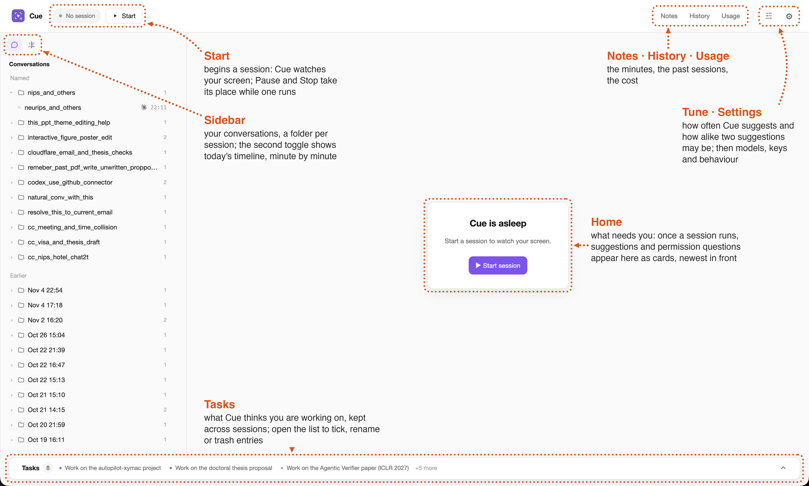

# Cue - Ambient Computer-Use Assistant

Different from traditional agents, ambient computer-use tries to incorporate **a new source of input** to align with the user's daily usage and boost productivity: a continuous stream capture of the user's screen. This means the agent can understand in real time what the user is working on, what projects they want to complete, and whether they need assistance, all without the user typing a single word/prompt.

## Quickstart

You need a **Claude** or **Codex** subscription, signed in with its CLI (a runnable `claude` or `codex` in your `$PATH`). It is the main agent of this computer-use assistant: every task Cue takes on in your chat is carried out by Claude Code or Codex.

Cue runs on a **Mac**, and installs with **Node.js 22.20.0** and **[uv](https://docs.astral.sh/uv/)**.

Run these commands in your terminal:

```bash
git clone https://github.com/jasonyux/cue
cd cue
corepack enable
pnpm install
pnpm run build   # the Python environment, the agent's browser and the console
```

Then launch the app:

```bash
pnpm cue web # recommended to be ran in background via stuff like tmux
```

Now open [http://127.0.0.1:3000](http://127.0.0.1:3000) in your browser and you are ready to go! Note that:
- For the first time, you might need to promted for **macOS permissions**. This application requires **Accessibility** and **Screen Recording** permission for the app you launch from (Terminal, iTerm, VS Code, …). Once granted, you may need to restart the app (i.e., restart the server with `pnpm cue web`).
- The first time you open it, a **quickstart** (gear icon -> quickstart) walks you through the setup in three steps: the agent, the models that take notes, keep your task list and suggest, and an API key for each provider those models come from ([OpenAI](https://platform.openai.com/api-keys), [Anthropic](https://console.anthropic.com/), [OpenRouter](https://openrouter.ai/keys), [LiteLLM](https://docs.litellm.ai/) or your own [vLLM](https://docs.vllm.ai/) server).
- To keep the page in its own window instead of a browser tab, we recommend you to **install this as a Progressive Web App (PWA)**. In chrome or edge, there should be a **+** icon/**install** button in the address bar to install it. In Safari, from the menu bar, choose **File → Add to Dock**.
- After pulling new code, run `pnpm run build` again: `pnpm cue web` serves what the last build made.

## Main Features

> TLDR: start a session and go do your own work for a while. The agent will watch your screen, keep track of your tasks, and propose what to do next to offload cumbersome tasks for you and let you focus on what matters. You can accept the agent's proposed task + interact with it or reject its proposal. Pause anytime; Stop ends the session and save it to history.



What each control does:
- **Start / Pause / Stop**: the buttons beside the session's state at the top left, on every page. **Start** begins a session (the home page's card offers it too), **Pause** pauses everything (looks, notes, tasks, suggestions, runs; paused time does not count against the limit) and **Stop** ends the session.
- **Sidebar**: the pair of toggles at its top switches between your conversations, a folder per session (the default), and the **Rail**: today's timeline, one row per minute: screenshots, notes, suggestions, your answers, agent runs and permission questions. Click one to open its record on the right; a suggestion comes to the front.
- **Cards**: what needs you, newest in front, the earlier ones behind; the tabs filter them (all, permissions, suggestions, answered) and ‹ › pages through them. A suggestion's **Accept** comes apart under the pointer into **Do it** (the agent runs it as written; with more than one agent set up, the picker beside it chooses which, until the conversation has one) and **Edit first** (the pen: the text goes to the chat box for you to change, and what you send is recorded next to the suggestion); **Not now** puts it off (for a while, or for good); **Details** and **Why?** show what it rests on, with the records it cites. A permission card asks about a new app (**Block**, **Look**, **Use**, **This session**) and an approval card holds an agent's call (**Allow once** / **Deny**).
- **Chat**: the conversation with the agent (the **Chat** button at the top opens it, **Home** brings the cards back); each message is one run, carrying what was observed since your previous message; the header picks the agent and its model. Under each reply, how long the agent worked folds its steps: what it said along the way, and its tool calls as one line each with their output (**raw** shows every event, for debugging). A monitor beside it shows the agent's screen as it works (for a coding agent with no screen: what it is doing now and the tail of that command's output) or **Cue's browser** (pick one on the monitor's bar, or follow the agent); **Take control** opens the browser full size so you can click, type and log in yourself (Esc to close). The monitor button in the bar hides it.
- **Tasks**: the bar at the bottom: what the agent believes you are working on, kept across sessions, with Sidequests apart. Open it to tick, rename, reopen or trash entries; thumbs up/down tell the agent what it got right.
- **Preferences**: every answer to a suggestion and every thumbs on a task is also read, every five minutes, by a preference updater that keeps a short file of your standing preferences (`python-app/data/memory/preferences.md`, 400 tokens at most), which every suggestion, every run and every task list update is given. It changes the file only when several reactions point the same way; edit it by hand if you like.
- **Notes**, **History**, **Usage** and **Settings** (the gear), at the top right: one line per minute of what you did; past sessions and their runs; cost per model and module; models, keys and behaviour. The button beside the gear tunes the suggestions: how often they come and how different from earlier ones they must be.

Everything a session records (screen captures, summaries, proposals, runs, costs) is stored under `python-app/data/` on your machine and nowhere else.

## Agents

A run (a chat turn or an accepted suggestion) is carried out by [Claude Code](https://claude.com/claude-code) or [Codex](https://developers.openai.com/codex), started by the server itself with your own login. **Settings → Agents for chat and temporary runs** sets which the session has; with both, each message picks. The agent brings its own tools (shell, files, git, the web) and gets two more from us:
- **Desktop**: our accessibility-based `ax` tools, which act on your Mac's apps in the background without moving your mouse or taking your focus, so you keep working meanwhile.
- **Browser**: a browser of its own ([Playwright MCP](https://github.com/microsoft/playwright-mcp) attached to a headless Chrome the server runs), whose logins are kept under `python-app/data/agent-browser` between sessions. You watch it on the monitor; **Take control** lets you log in or step in by hand. (Google accounts refuse to sign in inside an automated browser; most other sites are fine.)

Things to know:
- When Claude Code's permission mode (`auto` by default) or your own `ask` rules hold a call back, the approval card and the run card show **Allow once** / **Deny**, and Claude waits for your answer.
- Codex asks nothing of you on the run card: it works in its sandbox (files in its folder, no network for its shell), and Codex's own reviewer approves or denies any step beyond it; its verdicts show on the run card.
- The run uses your Claude or Codex login and reports its own cost, which the Usage page counts; the models on the Settings page are for the background modules only.

Each agent's settings, the optional remote desktop (an isolated container for the agent to work in) and the two deprecated agents are in [DEVELOPER.md](DEVELOPER.md#agents).

## Safety and Limitations

- Capturing all screen activity is definitely not good for privacy. **Settings → Advanced → Permissions** sets what may be read of each app and site: `block` (not even looked at: the notes only say you were there and for how long), `look`, or `use`, and what apps not listed get: a level, or `ask`, which blocks each new app until you answer its card (Block, Look, Use, or This session). Sites apply in any browser, so `chase.com: block` hides your bank wherever you open it. The agent's own tools do not follow these rules yet. Cue never looks at its own console.
- Generated code runs with your user permissions. Cue does not provide an operating-system sandbox or production action-review controls; the permission rules are applied by `ax`, which code the agent writes could bypass. Use the remote desktop or other environments you control for anything risky.
- The coding agents (`claude`, `codex`) run unattended with your user permissions, shell included. Choose Claude Code's permission mode and Codex's sandbox with that in mind: Claude Code's `auto` asks you for what it holds back, while Codex's own reviewer decides without asking.
- A final answer does not prove the task succeeded. Inspect the result before relying on it.
- Keep API keys and run artifacts private. Environment files and generated run data are excluded from Git; keep services on their default loopback addresses.

## For developers

[DEVELOPER.md](DEVELOPER.md) has the rest: the dev server (`pnpm cue dev`) with the other themes and the debug pages, the agents' settings, the remote desktop container, configuration tips and the checks.
